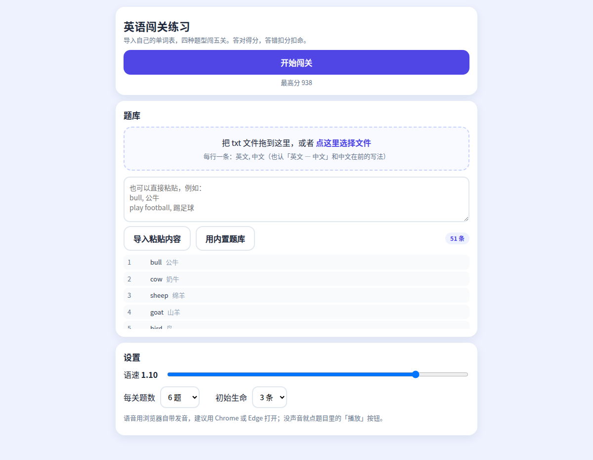

# 小学英语单词闯关

一个给小学生背单词用的单页小游戏：把自己的单词表导进去，七关、六类题型轮着练，答对有得分和连击奖励，答错扣分扣血，血用完就闯关失败。

**零依赖**：整个游戏就是一个 `index.html`，没有 CDN、没有字体文件、没有图片、没有音频，双击即用；发音用浏览器自带的语音合成（`speechSynthesis`）。

**在线玩**：<https://wuwuii.github.io/kids-english-quiz/>



## 快速开始

1. 下载 `index.html`，双击用 Chrome / Edge 打开
2. 在「题库」里粘贴、拖入或选择自己的单词表
3. 点「开始闯关」

单词表一行一条，两种写法都认：

```text
bull, 公牛
公牛 — bull
```

带逗号的句子也能正确切分（`Yes, they are., 是的，它们是。`）。导入时自动去重、跳过注释和标题行，并告诉你识别了几条、跳过了几行。

## 六类题型

| 题型 | 玩法 |
|---|---|
| 看图选词 | 图 + 四选一 |
| 中译英 | 中文 → 选英文 |
| 英译中 | 英文 → 选中文 |
| 连线配对 | 左边英文、右边中文，各 4 项，点选配对 |
| 听音选词 | 自动播报英文，点出听到的词 |
| 补全单词 / 句子填空 | 缺字母的格子从字母块里点选填入；句子只挖关键词 |

## 七关递进

| 关 | 内容 | 填空 |
|---|---|---|
| 1 | 看图选词 + 中译英 + 英译中 + 句子连线，全带图 | 不用填 |
| 2 | 看图选择 + 部分单词填写 + 连线 | 每词缺 1~2 个字母 |
| 3 | 同第 2 关，加听音选词 | 每词缺 1~2 个字母 |
| 4 | 单词缺一半，句子开始挖 1 个关键词 | 单词 1/2 |
| 5 | 同第 4 关，句子挖 1~2 个词，保留连线 | 单词 1/2 |
| 6 | 单词所有字母自己填，句子挖 2 个关键词 | 单词全空 |
| 7 | 默写关 | 单词全空，句子挖 2/3 |

答错会扣分并扣 1 点生命（连线/拼写错一次也扣），生命归零 → 本关作废，可以「重来本关」或回首页。错过的词会被加权抽到（约 75% 概率优先复习），一次不错地做对才算掌握。

## 可调项

- 语速 0.6 ~ 1.2
- 每关题数 8 / 10 / 12 / 15（默认 15）
- 初始生命 3 / 5

题库和设置存在浏览器 localStorage，下次打开还在。

## 兼容性

- Chrome / Edge / Safari 现代版本
- 手机竖屏适配（375px 无横向滚动）

## 已知限制

- 发音依赖系统自带英文音色。Windows 上的 Chrome / Edge 一般有；没有音色的环境听音题会退化成看选项，题仍可答。
- 看图题需要「题库文件夹」里同时有同名图片（png/jpg），单独选 txt 时只有文字题。
- 没有账号系统，数据只存在本机浏览器。

## 许可

MIT，可自由使用、修改、商用。
